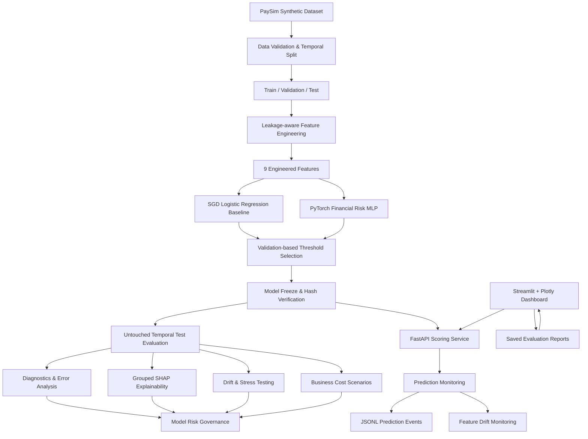

# Neural Financial Risk Prediction System

<p align="center">
  <strong>Neural Network vs. Conventional Machine Learning for Financial Fraud-Risk Prediction</strong>
</p>

<p align="center">
  
  
  
  
  
  
</p>

An end-to-end financial fraud-risk research platform that compares a PyTorch neural network against a conventional Logistic Regression baseline using a temporally split, highly imbalanced synthetic financial transaction dataset.

The project covers the complete model lifecycle: data preparation, leakage-aware feature engineering, model training, threshold selection, frozen temporal testing, explainability, error analysis, business-cost scenarios, drift analysis, stress testing, model governance, API inference, prediction monitoring, and an interactive analytics dashboard.

> **Deployment status: CONDITIONAL GO FOR SHADOW-ONLY EVALUATION.** This is a research and portfolio project built on synthetic PaySim data. It is not approved for autonomous production transaction decisions.

---

## Project at a glance

| Area | Implementation |
|---|---|
| Business problem | Financial transaction fraud-risk prediction |
| Dataset | PaySim synthetic financial transactions |
| Dataset size | 6,362,620 transactions |
| Positive class | 8,213 fraud transactions |
| Models | SGD-based Logistic Regression baseline and PyTorch MLP |
| Neural architecture | 9 → 64 → 32 → 1 |
| Feature count | 9 engineered features |
| Evaluation | Chronological train / validation / test |
| Explainability | Grouped SHAP analysis |
| Model serving | FastAPI |
| Monitoring | Prediction event logging and feature PSI |
| Dashboard | Streamlit + Plotly |
| Testing | Pytest |
| Inference mode | CPU |
| Governance | Shadow-only; no autonomous decisions |

## Held-out test results

The final test set contains **89,466 transactions**, including **1,252 fraud cases**. Both model thresholds were selected using validation data and frozen before final testing. No threshold tuning was performed on the test set.

| Metric | PyTorch MLP | Logistic Regression |
|---|---:|---:|
| PR-AUC | **0.9372** | 0.5836 |
| ROC-AUC | **0.9987** | 0.9642 |
| Precision | **82.80%** | 5.59% |
| Recall | 83.07% | **98.40%** |
| F1-score | **0.8293** | 0.1057 |
| Alert rate | **1.40%** | 24.65% |
| Alert count | 1,256 | 22,053 |
| False positives | 216 | 20,821 |
| False negatives | 212 | 20 |

The neural network substantially reduced the alert workload and improved precision on this particular temporal test set. The Logistic Regression baseline achieved higher recall, missing fewer fraud cases. Neither model dominates every operational objective.

### Test evaluation details

| Dataset partition | Time steps | Transactions | Fraud cases | Fraud prevalence |
|---|---:|---:|---:|---:|
| Train | 1–520 | 6,082,007 | 5,781 | 0.0951% |
| Validation | 521–631 | 191,147 | 1,180 | 0.6173% |
| Test | 632–743 | 89,466 | 1,252 | 1.3994% |

Test fraud prevalence was approximately **2.27 times** validation prevalence. This is an important distribution-shift consideration when interpreting the held-out results.

## Critical model limitation

Aggregate metrics do not tell the entire story.

The neural model missed **164 of 168 fraud cases** in the held-out **$50,000–$250,000 CASH_OUT** segment.

This is a material weakness and a reason the model must not be treated as an autonomous transaction decision system. Segment-level performance, especially for high-risk transaction patterns, requires further investigation and remediation.

## Illustrative business-cost analysis

A scenario analysis estimates operational costs using example assumptions:

- Low: $2 per false positive and $50 per false negative.
- Base: $5 per false positive and $150 per false negative.
- High: $10 per false positive and $500 per false negative.

| Scenario | Logistic Regression cost | Neural network cost | Estimated difference |
|---|---:|---:|---:|
| Low | $42,642 | $11,032 | $31,610 |
| Base | $107,105 | $32,880 | $74,225 |
| High | $218,210 | $108,160 | $110,050 |

These values are **illustrative scenario outputs**, not actual bank costs or realized savings. The cost assumptions must be replaced with institution-approved operational estimates before business use.

The neural model's gross missed-fraud transaction amount is approximately $26.35 million on this test set. This is a transaction exposure measure, **not verified realized financial loss**.

---

## System architecture



### Prediction lifecycle

1. A transaction is submitted to the FastAPI scoring endpoint.
2. The API validates the input using Pydantic.
3. The original training-fitted scaler and feature transformations are applied.
4. The frozen PyTorch model calculates a risk probability.
5. The probability is compared with the frozen validation threshold.
6. The API returns `REVIEW` or `NO_REVIEW`.
7. The prediction event is sent to the local monitoring component.
8. The dashboard can display historical evaluation reports and query the live API.

The API operates in `SHADOW_ONLY` mode. A `REVIEW` result is advisory and does not automatically approve, decline, or block a transaction.

---

## Feature engineering

The model uses nine features:

| Feature | Transformation |
|---|---|
| `step` | Standardized time step |
| `log_amount` | `log1p(amount)` then scaling |
| `log_oldbalanceOrg` | `log1p(oldbalanceOrg)` then scaling |
| `log_oldbalanceDest` | `log1p(oldbalanceDest)` then scaling |
| `type_CASH_IN` | One-hot transaction type |
| `type_CASH_OUT` | One-hot transaction type |
| `type_DEBIT` | One-hot transaction type |
| `type_PAYMENT` | One-hot transaction type |
| `type_TRANSFER` | One-hot transaction type |

The numerical scaler is fitted on training data only and reused for validation, test, and API inference. The feature order is recorded in metadata and the model-freeze manifest.

Account identifiers and fraud labels are not accepted by the scoring API.

## Models

### Logistic Regression baseline

The conventional baseline uses `SGDClassifier` with logistic loss, allowing scalable training on the large dataset.

### PyTorch neural network

The neural model is a feed-forward MLP:

```text
Input:       9 features
Hidden 1:    64 units + ReLU
Dropout:     0.2
Hidden 2:    32 units + ReLU
Output:      1 logit
```

Training configuration:

- Optimizer: AdamW
- Learning rate: 0.001
- Weight decay: 0.0001
- Fraud positive-class weight: 50
- Batch size: 4,096
- Early stopping with validation PR-AUC
- Best checkpoint: epoch 7
- Training device: CPU

The final neural model threshold is approximately `0.1444527954`. The Logistic Regression threshold is approximately `0.9318526983`. Both were selected using validation data and frozen before final test evaluation.

## Evaluation and model-risk analysis

The project includes:

- Precision, recall, F1, PR-AUC and ROC-AUC.
- Confusion matrices and alert-rate analysis.
- Brier score, log loss and calibration diagnostics.
- Alert-budget comparisons.
- Model-only CPU inference benchmarks.
- False-positive and false-negative analysis.
- Missed-fraud transaction exposure analysis.
- Transaction-type and amount-segment investigation.
- Temporal prevalence and feature drift audits.
- Independent and coherent financial stress testing.
- Grouped SHAP explainability.
- Illustrative business-cost scenarios.
- A model risk register and deployment decision.

### Explainability

Grouped SHAP analysis treats transaction type as one conceptual feature rather than interpreting each one-hot column independently.

SHAP explains how the model uses its inputs. It does not establish causality. Independent feature perturbations can also produce combinations that would not occur in realistic financial transactions.

### Drift and stress testing

Temporal fraud prevalence changes across the dataset partitions. Feature drift statistics are interpreted in the context of the deliberately chronological split. A large PSI value alone does not establish harmful concept drift.

Coherent financial stress testing preserves selected accounting relationships during perturbation. These synthetic tests help investigate model sensitivity; they do not demonstrate real-world resilience.

---

## Model governance decision

The current governance report records:

| Governance item | Decision |
|---|---|
| Overall decision | `CONDITIONAL_GO_FOR_SHADOW_ONLY` |
| Autonomous production | `NO_GO` |
| Human-reviewed controlled pilot | `NOT_YET_APPROVED` |
| Total identified risks | 12 |
| Critical risks | 7 |

Key unresolved production blockers include:

- Validation using representative real-world transactions and fraud labels.
- Remediation or formally accepted treatment of the weak CASH_OUT segment.
- Live monitoring, incident response and rollback procedures.
- Security, privacy and compliance approval.
- Human review, override and escalation governance.
- End-to-end service integration and load testing.

This governance decision is deliberately conservative: strong offline results on synthetic data are not sufficient evidence for production approval.

---

## API

The FastAPI service loads the frozen model once during startup and verifies the model artifact hash against the freeze manifest.

### Available endpoints

| Method | Endpoint | Purpose |
|---|---|---|
| GET | `/` | Service information |
| GET | `/health` | Health status |
| GET | `/model-info` | Model metadata and hashes |
| GET | `/deployment-policy` | Deployment restrictions |
| POST | `/predict` | Single transaction scoring |
| POST | `/predict/batch` | Batch scoring |
| GET | `/monitoring/summary` | Prediction monitoring summary |
| GET | `/monitoring/drift` | Feature drift status |

Interactive API documentation is available at `/docs` when the service is running.

### Example scoring request

```json
{
  "step": 650,
  "type": "CASH_OUT",
  "amount": 150000,
  "oldbalanceOrg": 150000,
  "oldbalanceDest": 50000
}
```

The API returns a risk probability, threshold-based advisory decision, model version, model hash, and deployment mode.

### Start the API

```powershell
uvicorn src.api.main:app --reload
```

API documentation:

```text
http://127.0.0.1:8000/docs
```

---

## Prediction monitoring

The monitoring component includes:

- Local JSONL prediction event logging.
- Prediction summary statistics.
- Feature-distribution PSI monitoring.
- A minimum sample-size safeguard.
- A matured-label evaluation workflow.
- Transaction-type and amount-segment evaluation.

The matured-label evaluation workflow can compare previously logged predictions with subsequently available labels. It does not automatically retrain the model or retune its threshold.

The current implementation is a local research monitoring component, not an immutable enterprise audit platform. Retention, access controls, alerting, incident response and operational security require further engineering.

---

## Interactive dashboard

The Streamlit dashboard contains nine sections:

1. Executive Overview
2. Model Comparison
3. Fraud Intelligence
4. Explainability
5. Drift & Stress
6. Business Impact
7. Live Risk Scoring
8. Prediction Monitoring
9. Model Governance

The historical analytics pages read saved project reports. Live scoring and monitoring sections connect to the FastAPI service when it is running.

### Start the dashboard

```powershell
python -m streamlit run dashboard/app.py
```

Open:

```text
http://localhost:8501
```

If the API runs at a different address, set the environment variable before starting Streamlit:

```powershell
$env:RISK_API_URL = "http://127.0.0.1:8000"
```

The dashboard does not need to load the full raw dataset or multi-million-row feature files.

---

## Project structure

```text
neural-financial-risk-prediction/
│
├── config/
├── configs/
│
├── data/
│   ├── raw/
│   ├── interim/
│   └── processed/
│
├── models/
│   ├── baseline/
│   └── neural_network/
│
├── reports/
│   ├── experiments/
│   ├── diagnostics/
│   ├── final_evaluation/
│   ├── model_freeze/
│   ├── error_analysis/
│   ├── missed_fraud_exposure/
│   ├── cashout_failure_analysis/
│   ├── temporal_drift_audit/
│   ├── formal_feature_drift/
│   ├── segment_level_fraud_drift/
│   ├── grouped_shap_explainability/
│   ├── robustness_stress_test/
│   ├── coherent_financial_stress_test/
│   ├── business_impact/
│   ├── model_governance/
│   └── monitoring/
│
├── src/
│   ├── api/
│   ├── data/
│   ├── evaluation/
│   ├── features/
│   ├── governance/
│   ├── models/
│   ├── monitoring/
│   ├── training/
│   └── utils/
│
├── dashboard/
│   └── app.py
│
├── docs/
├── tests/
├── requirements.txt
└── README.md
```

## Installation

### 1. Clone the repository

```powershell
git clone https://github.com/Rauof-Qadir/neural-financial-risk-prediction.git

cd neural-financial-risk-prediction
```

### 2. Create and activate a virtual environment

```powershell
py -3.14 -m venv .venv

.\.venv\Scripts\Activate.ps1
```

### 3. Install dependencies

```powershell
python -m pip install --upgrade pip

pip install -r requirements.txt
```

### 4. Add the dataset

Download the PaySim dataset from:

https://www.kaggle.com/datasets/ealaxi/paysim1

Place the raw CSV at:

```text
data/raw/PS_20174392719_1491204439457_log.csv
```

The dataset is synthetic. Follow the dataset provider's terms and attribution requirements when redistributing it.

### 5. Run the API and dashboard

Start the API in one terminal:

```powershell
uvicorn src.api.main:app --reload
```

Start the dashboard in another terminal:

```powershell
python -m streamlit run dashboard/app.py
```

The checked-in evaluation reports and model artifacts are required for the dashboard and API respectively. A fresh clone may need the corresponding artifacts and dataset to be obtained or generated before all features can run.

## Testing

Run the project test suite:

```powershell
python -m pytest -q
```

Some tests and workflows require local model artifacts or prepared dataset files. Run them from the repository root with the project virtual environment activated.

## Technology stack

- **Language:** Python
- **Data processing:** Pandas, NumPy, PyArrow
- **Machine learning:** Scikit-learn
- **Deep learning:** PyTorch
- **Explainability:** SHAP
- **API:** FastAPI, Pydantic, Uvicorn
- **Dashboard:** Streamlit, Plotly
- **Testing:** Pytest
- **Model persistence:** Joblib, PyTorch checkpoints
- **Monitoring:** JSONL, PSI-based feature monitoring
- **Version control:** Git and GitHub

## Limitations and responsible use

- PaySim is synthetic and does not reproduce every real banking behavior.
- A single temporal holdout is not evidence of performance across institutions or future production periods.
- Fraud prevalence and transaction patterns differ across temporal partitions.
- The neural model has a material weakness in the tested mid-range CASH_OUT segment.
- Cost scenarios rely on illustrative assumptions.
- Gross missed transaction amount is not verified financial loss.
- SHAP explanations are not causal explanations.
- Stress-test results depend on the selected perturbations.
- The API does not include production-grade authentication, rate limiting, TLS termination, or enterprise audit controls.
- Human review, privacy, security, compliance and operational approval remain necessary.

**Do not use this project to autonomously approve, reject, or block real financial transactions.**

## Author

**Rauof Qadir**
Software Engineering Graduate · Data Science · Machine Learning · Financial Risk Analytics

GitHub: https://github.com/Rauof-Qadir

---

*Built as an end-to-end financial ML engineering and model-risk research project. Results and governance decisions are tied to the saved synthetic-data evaluation artifacts in this repository.*